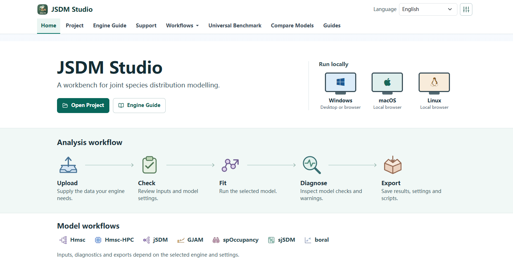

# JSDM Studio

A local workbench for joint species distribution modelling. It guides data checks, model fitting, diagnostics, prediction and reproducible exports across Hmsc, Hmsc-HPC, jSDM, GJAM, spOccupancy, sjSDM and boral.

## Get started

Download the [0.4.8 installer for Windows, macOS or Linux](https://github.com/gujiqi/JSDM_Studio/releases/tag/v0.4.8). Windows x64 uses one full offline EXE. Linux requires internet access for its first installation. The macOS packages have passed offline-dependency checks but have **not** been installed on physical Mac hardware.

[Installation guide](https://github.com/gujiqi/JSDM_Studio/releases/download/v0.4.8/START_HERE.md) · [Checksums](https://github.com/gujiqi/JSDM_Studio/releases/download/v0.4.8/SHA256SUMS.txt) · [Runtime source snapshot](https://github.com/gujiqi/JSDM_Studio/releases/download/v0.4.8/JSDMStudio_0.4.8_Runtime_Source.zip)

The repository contains the synced 0.4.8 runtime source. The older `v0.4.8` tag and GitHub's automatic source archive are **not** a verified build recipe for the installer binaries; see the [source scope note](https://github.com/gujiqi/JSDM_Studio/releases/download/v0.4.8/SOURCE_SCOPE.md).
