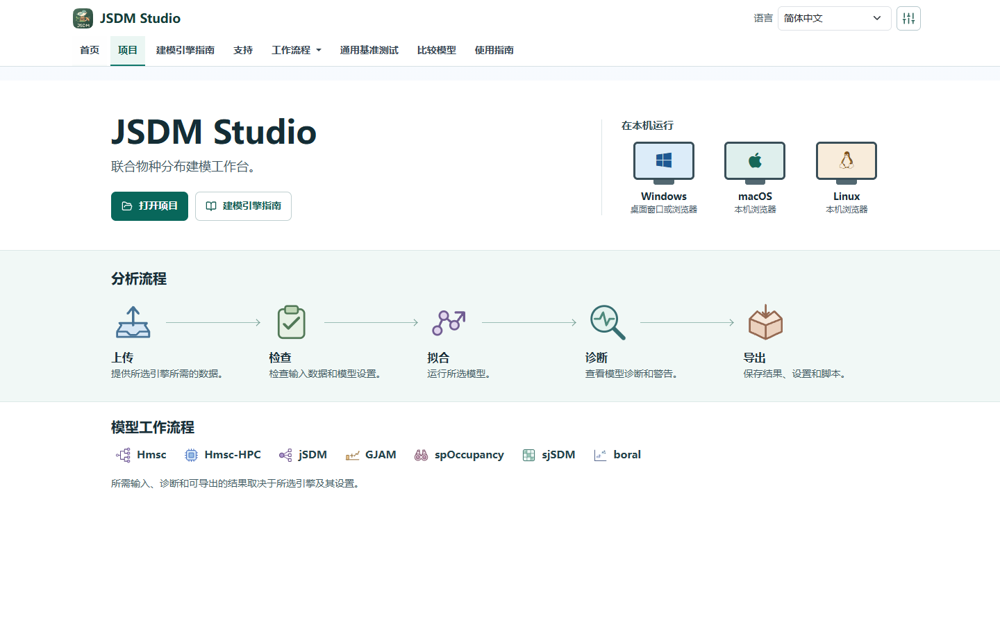

# JSDM Studio

JSDM Studio is a local workbench for joint species distribution modelling. Upload ecological data, check the inputs, fit an engine-specific model, inspect diagnostics and predictions, and export results with the settings and scripts needed to audit the analysis.

It includes guided workflows for **Hmsc, Hmsc-HPC, jSDM, GJAM, spOccupancy, sjSDM and boral**, plus a Universal Benchmark. Outputs from different engines are labelled by their model-specific meaning; residual associations are not presented as interchangeable quantities.

## Install

Download the appropriate package from [JSDM Studio 0.4.8 Releases](https://github.com/gujiqi/JSDM_Studio/releases/tag/v0.4.8):

| Platform | Package | Note |
| --- | --- | --- |
| Windows x64 | [Full offline installer](https://github.com/gujiqi/JSDM_Studio/releases/download/v0.4.8/JSDMStudio_0.4.8_Windows_x64_Full_Offline.exe) | One EXE; run as administrator. The required runtime and CPU dependencies are bundled. |
| macOS Apple Silicon | [Offline archive](https://github.com/gujiqi/JSDM_Studio/releases/download/v0.4.8/JSDMStudio_0.4.8_macOS_Apple_Silicon_Offline.zip) | macOS 14+; physical Mac installation has not been verified. |
| macOS Intel | [Offline archive](https://github.com/gujiqi/JSDM_Studio/releases/download/v0.4.8/JSDMStudio_0.4.8_macOS_Intel_Offline.zip) | macOS 14+; physical Mac installation has not been verified. |
| Ubuntu 24.04 x64 | [Browser edition](https://github.com/gujiqi/JSDM_Studio/releases/download/v0.4.8/JSDMStudio_0.4.8_Linux_Browser.zip) | First installation requires internet access. |

Read the [installation guide](https://github.com/gujiqi/JSDM_Studio/releases/download/v0.4.8/START_HERE.md), [validation report](https://github.com/gujiqi/JSDM_Studio/releases/download/v0.4.8/INSTALLATION_AND_LANGUAGE_AUDIT.md) and [SHA-256 checksums](https://github.com/gujiqi/JSDM_Studio/releases/download/v0.4.8/SHA256SUMS.txt) before installing. Windows and Ubuntu underwent installation and seven-engine smoke tests; macOS packages underwent dependency and architecture checks, not installation on a physical Mac. The interface offers 15 languages; some help text remains in English.

## Source

The [0.4.8 runtime source snapshot](https://github.com/gujiqi/JSDM_Studio/releases/download/v0.4.8/JSDMStudio_0.4.8_Runtime_Source.zip) comes from the published application package. Read its [scope and provenance note](https://github.com/gujiqi/JSDM_Studio/releases/download/v0.4.8/SOURCE_SCOPE.md): this repository's automatic source archive does **not** reproduce the installer binaries byte-for-byte. The screenshot and icon above are from the 0.4.8 application, while the repository source tree is being brought into sync separately.
